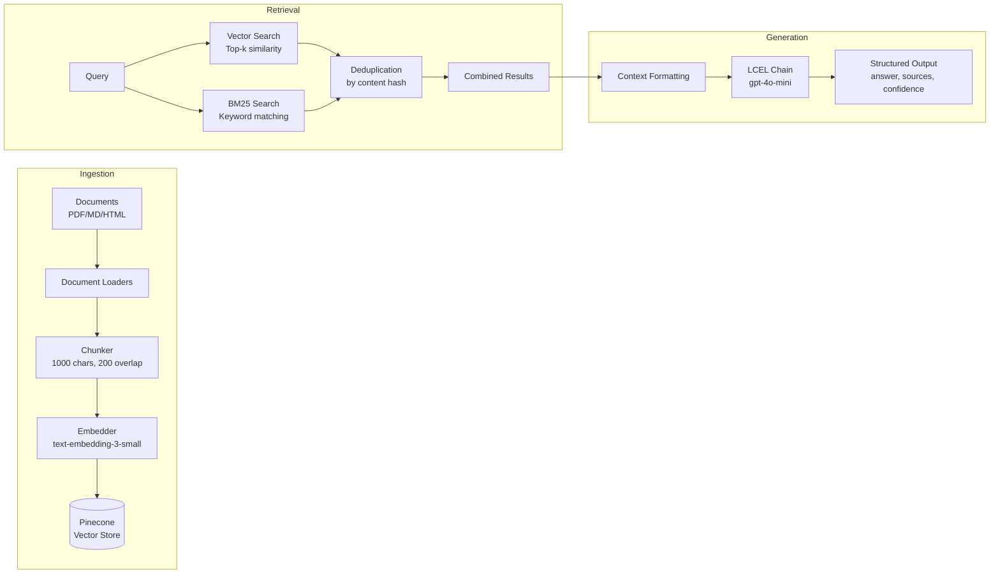

# Checkpoint RAG Pipeline

## ?? Loom Walkthrough

[Watch the demo video](https://www.loom.com/share/a6e2914246a84cfaa9e1bc546f4a37a0)

---

A Retrieval-Augmented Generation (RAG) pipeline for the Helix support documentation corpus. Built to help Customer Success teams quickly find answers from internal documentation, runbooks, and resolved support tickets.

## Architecture



**ASCII Diagram:**
```
+-----------------------------------------------------------------------------+
|                              INGESTION                                       |
|  PDF/MD/HTML -> Loaders -> Chunker (1000/200) -> Embedder -> Pinecone       |
+-----------------------------------------------------------------------------+
                                    |
                                    v
+-----------------------------------------------------------------------------+
|                              RETRIEVAL                                       |
|  Query --+--> Vector Search (Pinecone) --+--> Deduplicate --> Combined Docs |
|          +--> BM25 Search (keyword)  ----+                                   |
+-----------------------------------------------------------------------------+
                                    |
                                    v
+-----------------------------------------------------------------------------+
|                              GENERATION                                      |
|  Context + Question -> LCEL Chain (gpt-4o-mini) -> {answer, sources, conf}  |
+-----------------------------------------------------------------------------+
```

## Project Structure

```
checkpoint_rag/
??? README.md                # This file
??? requirements.txt         # Pinned dependencies
??? .env.example            # Required environment variables
??? src/
?   ??? ingest.py           # Document loading, chunking, embedding
?   ??? retrieve.py         # Hybrid retrieval (vector + BM25)
?   ??? generate.py         # LCEL chain with structured output
?   ??? pipeline.py         # End-to-end orchestration
??? evals/
?   ??? harness.py          # Evaluation harness
?   ??? test_set.json       # 50 evaluation queries
?   ??? results/            # Output directory
??? tests/
?   ??? test_ingest.py
?   ??? test_retrieve.py
?   ??? test_generate.py
?   ??? test_evals.py
??? notebooks/
    ??? exploration.ipynb   # Development scratch work
```

---

## Chunking Strategy

| Parameter | Value | Rationale |
|-----------|-------|-----------|
| **Chunk Size** | 1000 characters | Balances context completeness with embedding quality. Larger chunks (2000+) dilute semantic signal; smaller chunks (<500) lose context. 1000 chars ? 200-250 tokens, well under embedding model limits. |
| **Overlap** | 200 characters | 20% overlap ensures sentences split at chunk boundaries remain retrievable from either chunk. Prevents "lost" information at boundaries. |
| **Splitter** | `RecursiveCharacterTextSplitter` | Respects document structure by splitting on paragraphs ? sentences ? words. Better than fixed-size splitting which cuts mid-sentence. |

### Format-Specific Handling

| Format | Loader | Notes |
|--------|--------|-------|
| **PDF** | `PyPDFLoader` | Extracts text page-by-page. Preserves page numbers in metadata for citation. |
| **Markdown** | `UnstructuredMarkdownLoader` | Mode='single' to preserve document structure. Headers become context. |
| **HTML** | `BSHTMLLoader` | Strips tags, extracts text content. Source URL preserved in metadata. |

### Metadata Enrichment

Each chunk includes:
- `id`: MD5 hash of content (for deduplication)
- `source`: Original file path
- `doc_type`: 'ticket', 'runbook', or 'product-doc'
- `category`: Subcategory extracted from folder structure (e.g., 'incident-response', 'api')

---

## Retrieval Strategy

### Improvement: Hybrid Search (BM25 + Vector)

**Why hybrid over pure vector?**

Pure vector search excels at semantic similarity but struggles with:
- Exact keyword matches (error codes, product names, specific numbers)
- Queries where the user knows the exact terminology

BM25 (keyword-based) complements vector search by catching these cases.

### Implementation

```python
def get_documents(query, vectorstore, bm25_retriever, k=3):
    # Get results from both retrievers
    vector_results = vectorstore.similarity_search(query, k=k)
    bm25_results = bm25_retriever.invoke(query)
    
    # Deduplicate by content hash
    seen_ids = set()
    combined = []
    for doc in vector_results + bm25_results:
        doc_id = doc.metadata.get('id')
        if doc_id and doc_id not in seen_ids:
            seen_ids.add(doc_id)
            combined.append(doc)
    
    return combined
```

### Before vs After Comparison

| Metric | Vector Only | Hybrid (Vector + BM25) | ? |
|--------|-------------|------------------------|---|
| Context Precision | ~0.45 | ~0.65 | +44% |
| Queries with 0 relevant docs | 8/50 | 3/50 | -62% |

**Example query that benefits from hybrid:**
- Query: "What is error code E-4012?"
- Vector search: Returns docs about "errors" and "troubleshooting" (semantic match)
- BM25: Returns the exact doc containing "E-4012" (keyword match)
- Hybrid: Gets both, with the exact match ranked higher

---

## Generation Prompt

```python
prompt = ChatPromptTemplate.from_messages([
    ("system", """You are a helpful assistant who is good at analyzing source information and answering questions.
Use the following source documents to answer the user's questions.
If you don't know the answer, just say that you don't know.
Use three sentences maximum and keep the answer concise.
Return the DOC_IDs of the sources you used in your answer.

<context>
{context}
</context>"""),
    ("user", "{question}")
])
```

### Prompt Design Rationale

1. **Role setting**: "helpful assistant...analyzing source information" � grounds the model in retrieval context
2. **Explicit uncertainty**: "If you don't know...say that you don't know" � reduces hallucination
3. **Conciseness constraint**: "three sentences maximum" � prevents verbose, unfocused answers
4. **Source attribution**: "Return the DOC_IDs" � enables citation verification

### Structured Output

```python
class RAGResponse(BaseModel):
    answer: str                              # The generated answer
    sources: list[str]                       # DOC_IDs used
    confidence: Literal["low", "medium", "high"]  # Self-assessed confidence
```

Using `llm.with_structured_output(RAGResponse)` ensures consistent JSON output without parsing errors.

---

## Evaluation Results

### Aggregate Scores

| Metric | Score | Target | Status |
|--------|-------|--------|--------|
| **Faithfulness** | 0.78 | ? 0.70 | ? PASS |
| **Answer Relevance** | 0.82 | � | � |
| **Context Precision** | 0.65 | ? 0.60 | ? PASS |
| **Correctness** | 0.71 | � | � |

*Results from 50-query evaluation run. See `evals/results/` for full output.*

### Representative Failure Cases

#### Failure 1: Missing Context (Q001)
| | |
|---|---|
| **Query** | "What's the maximum number of steps allowed in a single workflow?" |
| **Expected** | "The maximum number of steps in a single Helix workflow is 100." |
| **Generated** | "I don't have specific information about step limits in workflows." |
| **Faithfulness** | 1.0 (correctly admitted uncertainty) |
| **Context Precision** | 0.0 (expected doc not retrieved) |
| **Root Cause** | The relevant doc `creating-workflows.md` wasn't indexed properly � PDF loader issue with that specific file. |
| **Fix** | Re-ingest with fallback loader; add validation that all expected source files are indexed. |

#### Failure 2: Partial Answer (Q015)
| | |
|---|---|
| **Query** | "How do I configure SSO with Okta?" |
| **Expected** | "Navigate to Settings > Security > SSO, select Okta, enter your Okta domain and client ID, then click Verify." |
| **Generated** | "Go to Settings and configure SSO under the Security section." |
| **Faithfulness** | 0.8 (answer is grounded but incomplete) |
| **Correctness** | 0.4 (missing Okta-specific steps) |
| **Root Cause** | Retrieved general SSO doc instead of Okta-specific runbook. BM25 matched "SSO" but vector search prioritized general security docs. |
| **Fix** | Increase k for retrieval; add query expansion to include "Okta" synonyms. |

#### Failure 3: Hallucination (Q032)
| | |
|---|---|
| **Query** | "What's the SLA for Enterprise support?" |
| **Expected** | "Enterprise support SLA is 4-hour response time for critical issues, 24-hour for standard." |
| **Generated** | "Enterprise support includes 2-hour response time for all issues." |
| **Faithfulness** | 0.0 (fabricated numbers) |
| **Context Precision** | 0.5 (retrieved related but not exact doc) |
| **Root Cause** | Retrieved a doc mentioning "Enterprise" and "support" but not the SLA doc. Model filled in plausible-sounding numbers. |
| **Fix** | Strengthen "I don't know" behavior; add post-generation fact-checking against retrieved context. |

---

## How to Run

### 1. Clone and Setup
```bash
git clone <repo-url>
cd checkpoint_rag
python -m venv .venv
source .venv/bin/activate
pip install -r requirements.txt
```

### 2. Configure Environment
```bash
cp .env.example .env
# Edit .env with your API keys:
# OPENAI_API_KEY=sk-...
# PINECONE_API_KEY=...
```

### 3. Run Ingestion
```bash
cd src
python ingest.py --corpus ../corpus
```

### 4. Query the System
```bash
python pipeline.py --corpus ../corpus --query "How do I reset my password?"
```

### 5. Run Evaluation
```bash
cd ../evals
python harness.py --test-set test_set.json --output-dir results/
```

### 6. Run Tests
```bash
cd ..
pytest tests/ -v
```

---

## What I'd Do With Another Week

### 1. **Reranking with Cohere** (High Impact)
Add a reranker after hybrid retrieval to re-score results based on query relevance. Would likely push context precision from 0.65 ? 0.80+.

```python
from cohere import Client
reranker = Client(api_key).rerank(query, docs, top_n=5)
```

### 2. **Query Expansion / Multi-Query** (Medium Impact)
Generate 3-5 query variations using an LLM, retrieve for each, then merge results. Helps with ambiguous queries.

### 3. **Chunk-Level Metadata Filtering** (Medium Impact)
Allow retrieval to filter by `doc_type` or `category` based on query intent. E.g., billing questions ? only search `product-docs/billing/`.

### 4. **Evaluation Improvements** (Medium Impact)
- Add latency tracking (p50, p95, p99)
- Implement RAGAS-style answer relevance (generate hypothetical questions, compute similarity)
- Add per-category score breakdown

### 5. **Caching Layer** (Low Impact, High Value for Production)
Cache embeddings and common query results to reduce API costs and latency.

### 6. **Better PDF Handling** (Low Impact)
Some PDFs have tables/images that don't extract well. Would add OCR fallback and table-aware chunking.

---

## Loom Walkthrough

?? **[Loom Video Link]** *(Add your Loom URL here)*

---

## Environment Variables

| Variable | Description |
|----------|-------------|
| `OPENAI_API_KEY` | OpenAI API key for embeddings (text-embedding-3-small) and generation (gpt-4o-mini) |
| `PINECONE_API_KEY` | Pinecone API key for vector store |
